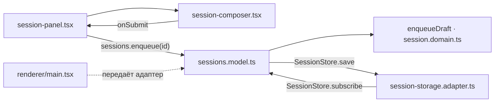

# Архитектура StepanFactory

Код разложен по фичам. Всё, что нужно для одной возможности приложения, лежит в одной папке `src/features/<фича>/`. Роль файла видна по суффиксу имени, а Oxlint проверяет, какие роли могут импортировать друг друга.

Строгих границ три:

1. **main и renderer.** Main-процесс работает с ОС и Electron. Renderer получает от него данные только через IPC.
2. **Платформенные API только в адаптерах.** `sessionStorage`, `fetch`, `location`, `crypto` и другие глобальные объекты браузера доступны в `*.adapter.ts` и в точке сборки `src/renderer/main.tsx`.
3. **Чистые функции без фреймворков.** `*.domain.ts` не импортирует пакеты и компилируется отдельно с типами ECMAScript. У каждого такого файла есть тест.

## Дерево

```
src/
├── main/index.ts                    окно Electron
├── renderer/
│   ├── index.html, styles.css
│   └── main.tsx                     адаптеры → модели → React
└── features/
    ├── navigation/
    │   ├── navigation.types.ts      Route, Section
    │   ├── navigation.constants.ts  список разделов, префиксы путей
    │   ├── navigation.domain.ts     parseRoute, sessionPath  (+ .test.ts)
    │   ├── navigation.model.types.ts  Navigation (интерфейс адаптера), NavigationModel
    │   ├── navigation.model.ts      route, href, openSession
    │   └── hash-navigation.adapter.ts
    ├── sessions/
    │   ├── session.types.ts         Session, SessionStore (интерфейс хранилища)
    │   ├── session.domain.ts        createSession, enqueueDraft, replaceSession  (+ .test.ts)
    │   ├── sessions.model.types.ts  SessionsModel
    │   ├── sessions.model.ts        list по подписке, current, create, update, enqueue
    │   ├── session-storage.adapter.ts
    │   ├── session-panel.tsx        очередь, вкладки, форма
    │   ├── session-composer.tsx     форма только на props  (+ .types.ts)
    │   └── session-list.tsx
    └── workspace/
        ├── workspace.types.ts, workspace.context.ts   модели для React
        ├── workspace.tsx            раскладка окна
        ├── workspace-screen.tsx     экран по route
        └── sidebar.tsx, dashboard.tsx, section-page.tsx
```

Вложенных папок внутри фичи нет. Если фича разрослась, её делят на две фичи.

## Роли файлов

| Суффикс | Что лежит | Импортирует из проекта | Пакеты |
| --- | --- | --- | --- |
| `*.types.ts` | Интерфейсы и типы | `*.types.ts` | типы `@reatom/core`, `react` |
| `*.constants.ts` | Экспортируемые данные | `*.constants.ts`, типы | — |
| `*.domain.ts` | Чистые функции над данными | `*.domain.ts`, типы, константы | — |
| `*.test.ts` | Тесты vitest рядом с проверяемым файлом | `*.domain.ts`, типы, константы | `vitest` |
| `*.model.ts` | Атомы, `computed` и действия Reatom. Фабрика получает адаптеры параметрами | модели, домен, типы, константы | `@reatom/core` |
| `*.adapter.ts` | Доступ к браузеру, хранилищу, сети | адаптеры, домен, типы, константы | `@reatom/core`, `ky` |
| `*.context.ts` | React-контекст с моделями | контексты, типы | `react` |
| `*.tsx` | Компоненты | компоненты, контексты, домен, типы, константы | `react`, `@reatom/core`, `@reatom/react`, `@base-ui/react` |
| `src/renderer/main.tsx` | Сборка: адаптеры, модели, монтирование | всё в `features/` | `react`, `react-dom`, Reatom |
| `src/main/**` | Main-процесс | main, домен, типы, константы | модули Node, `electron` |

Компонент получает модель только через `useWorkspace()`. Импортировать модуль модели или адаптера из компонента нельзя, только типы.

## Как сообщение попадает в очередь



1. Экран сессии выбирается по `route` модели навигации. [Экран](../src/features/workspace/workspace-screen.tsx)
2. Панель передаёт форме черновик, доступность кнопки и обработчики. Форма вызывает `onSubmit`, панель вызывает `sessions.enqueue(session.id)`. [Панель](../src/features/sessions/session-panel.tsx) · [Форма](../src/features/sessions/session-composer.tsx)
3. Модель берёт сессию из `SessionStore` и передаёт её в `enqueueDraft`. Функция убирает крайние пробелы, добавляет сообщение в конец очереди и очищает черновик. Для пробельного черновика она возвращает `undefined`, и модель ничего не сохраняет. [Модель](../src/features/sessions/sessions.model.ts) · [Домен](../src/features/sessions/session.domain.ts) · [Тесты](../src/features/sessions/session.domain.test.ts)
4. Адаптер сохраняет сессию в `sessionStorage` и уведомляет подписчиков. Модель читает обновлённый список через тот же интерфейс, поэтому другой адаптер, например IPC к main-процессу, подключается без изменений в модели и интерфейсе. [Интерфейс](../src/features/sessions/session.types.ts) · [Адаптер](../src/features/sessions/session-storage.adapter.ts) · [Сборка](../src/renderer/main.tsx)

Создание сессии идёт тем же путём. Модель сохраняет новую сессию и вызывает `navigation.openSession(id)`. Адаптер навигации меняет hash, а ссылки в интерфейсе строит `navigation.href()`, поэтому компоненты не знают, как устроен URL.

## Что проверяет линтер

| Правило | Что ловит |
| --- | --- |
| `project/file-roles` | Файл без роли или вне `features/<фича>/`, импорт в обход таблицы ролей, лишний пакет, `*.domain.ts` без теста, тест без проверяемого файла |
| `no-restricted-globals` | `window`, `document`, `location`, `history`, хранилища, сеть, `navigator`, `crypto` вне адаптеров |
| `project/filename-export` | Компонент назван не так, как файл |
| `project/constants-file` | Экспортируемые данные вне `*.constants.ts` и функции внутри него |
| `project/no-barrel` | `export *` и реэкспорт из другого модуля |
| `project/promise-chains` | `.then()` и `.finally()`, `.catch()` не в конце отдельной инструкции |
| `project/react-state` и `no-restricted-imports` | `useState`, `useEffect`, `useMemo`, `useCallback` и другие хуки состояния в компонентах |

Сообщение каждой ошибки говорит, что сделать вместо запрещённого. Негативные примеры лежат в [docs-lint/rejected](../docs-lint/rejected/), `npm run docs-lint` проверяет, что каждое правило срабатывает на нужной строке.

`npm run check` запускает проверку типов, Oxlint, тесты vitest и docs-lint. Сборка выполняет ту же команду.

## Как планировать изменение

Линтер ловит нарушения границ, но не решает, хороша ли сама структура. Это решается до кода:

1. Для задачи крупнее одной правки агент сначала показывает дерево файлов в виде диффа (`NEW`, `MODIFIED`, `DELETED`) и сигнатуры новых функций и типов.
2. Изменение делается тонким вертикальным срезом: от компонента до адаптера для одной возможности, а не слой за слоем.
3. Ревью идёт порциями по 100–200 строк, между ними можно поправить направление.
