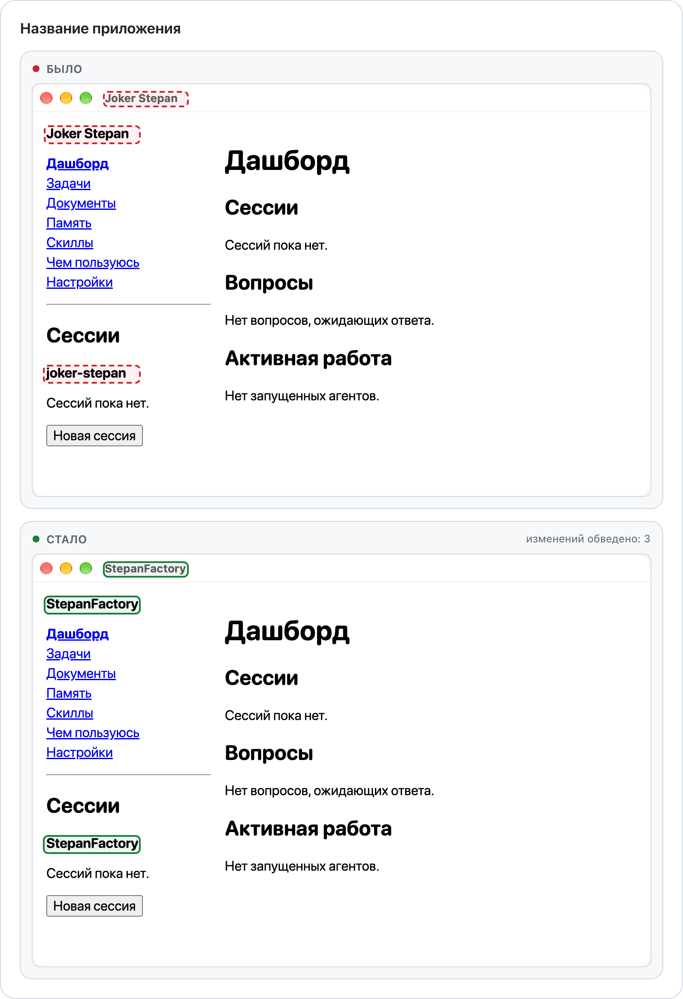
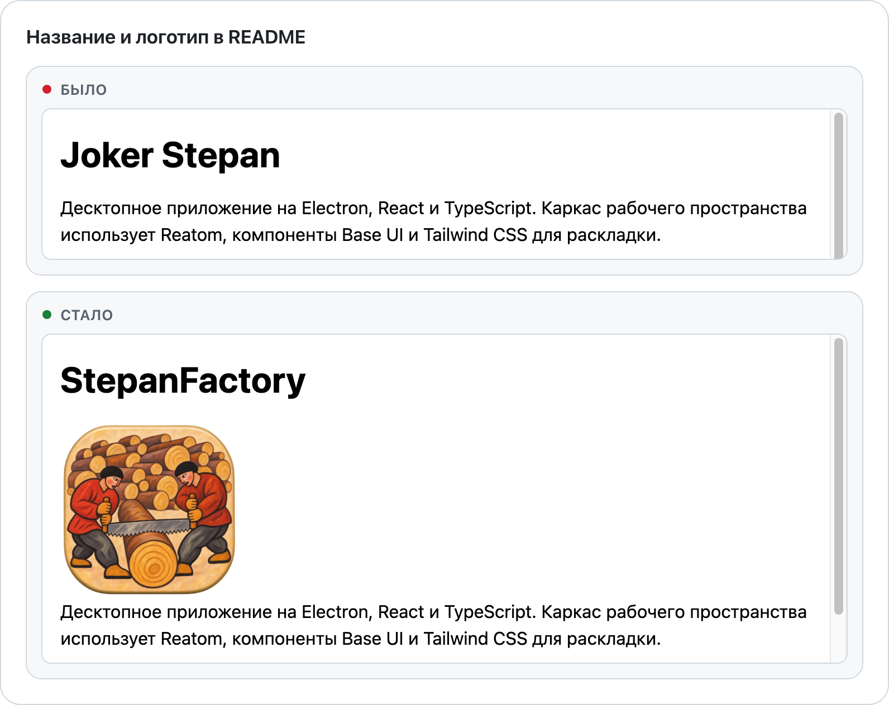
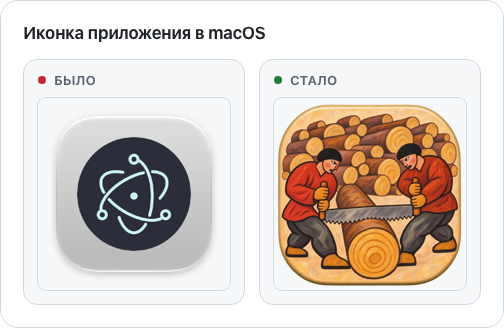

# Переименование в StepanFactory

## Окно приложения

Новое имя видно в заголовке окна, в боковой панели и в списке проектов. Обе версии сняты на пустом дашборде в окне Electron размером 720 × 480.

## README

На первой странице документации под названием StepanFactory появился логотип. Обе версии README показаны в одном локальном Markdown-просмотрщике.

## Иконка в macOS

После запуска StepanFactory в Dock используется логотип с лесорубами. Для сравнения иконки прочитаны из `NSApp.applicationIconImage` двух запущенных версий.

## Проверка

Прежний экран собран из исходников, сохранённых в истории разработки до переименования. Имя собранного файла с хешем (`index-DkwPmFYJ.js`) совпало с результатом первоначальной сборки. Текущая версия прошла `npm run build`.
